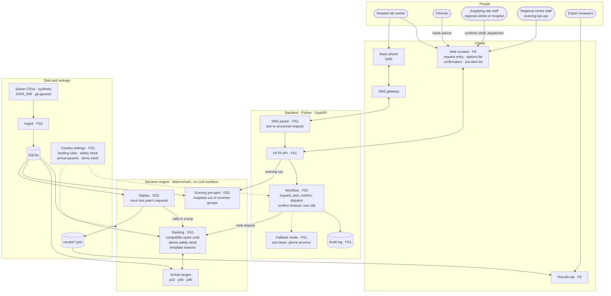
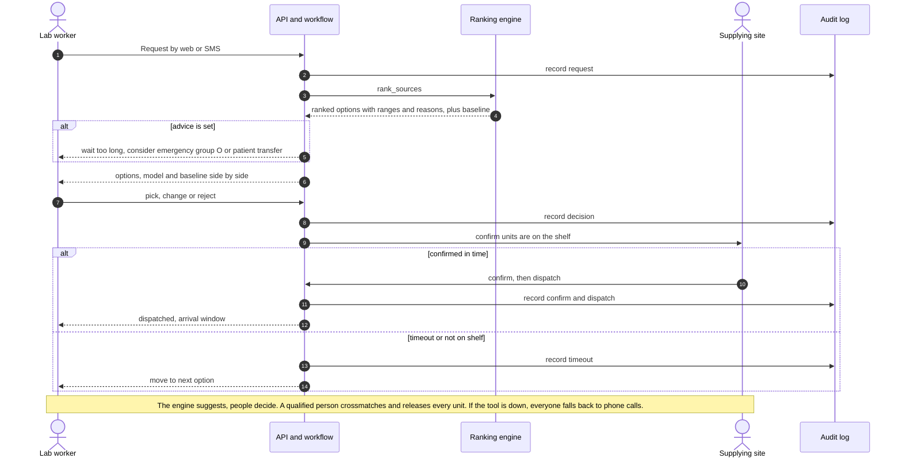
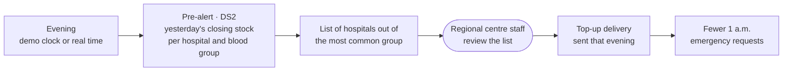
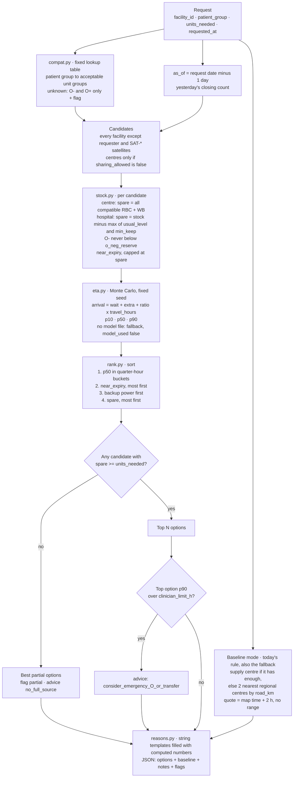

# System architecture

Four views:

1. **Whole system**: every component, who owns it, and how data flows.
2. **Emergency request**: who does what, in order, during a 1 a.m. request.
3. **Evening pre-alert**: topping hospitals up before the night's emergencies.
4. **Zoom: ranking engine**: what happens inside one `rank_sources()` call ([spec](../RANKING_ENGINE_SPEC.md)).

Owners: **FS1** Full-stack 1 · **FS2** Full-stack 2 · **DS1** Data scientist 1 · **DS2** Data scientist 2 · **FE** Frontend.

## 1. Whole system

## 2. Emergency request

## 3. Evening pre-alert

## 4. Zoom: ranking engine, one `rank_sources()` call

## Safety principles and where they live

| Principle | Where |
|---|---|
| A person makes every decision; the tool suggests | Workflow: pick, confirm, dispatch are human steps |
| The tool never decides blood group; unknown group means group O only | Ranking (`compat.py`) |
| Compatibility is a fixed lookup table, never a model | Ranking (`compat.py`) |
| Every time estimate has a range (p10 / p50 / p90) | Arrival ranges |
| No LLM produces any number; reasons are templates | Ranking (`reasons.py`) |
| A hospital lends only what it can spare; O- reserve is protected | Ranking (`stock.py`) + country settings |
| Stock is yesterday's count until the supplying site confirms | Workflow confirm step + `stock_note` |
| Every action is recorded | Audit log |
| If the tool fails, everyone falls back to the phone process | Fallback mode |
| A new country is a new settings file, no code change | Country settings |
| No patient identifier is collected; the engine stores only the request fields it uses | Ranking (`load.py`); see [DATA_PROTECTION.md](../DATA_PROTECTION.md) |
